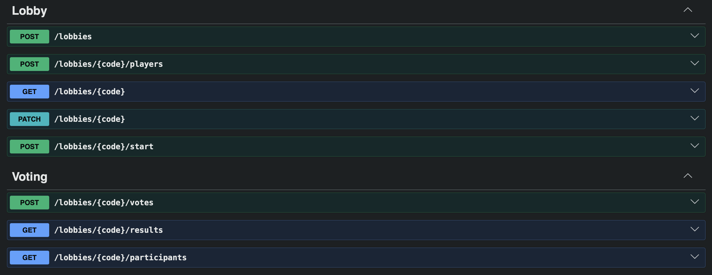

# EuroVoteVision

Vote on Eurovision entries with your friends and see how your group would have
changed the official results — as if you were one more jury.

## Stack

NestJS · TypeScript · Prisma · PostgreSQL · Docker · Swagger



## Getting started

```bash
npm install
docker compose up -d
cp .env.example .env
npx prisma generate
npx prisma migrate deploy
npx prisma db seed
npm run start:dev
```

API documentation is served at `http://localhost:3000/api`.

## How it works

The host creates a lobby and gets a five-character join code to share. They pick
the voting mode and the contest year (2026 is currently seeded), then start the
round with a timer of five to ten minutes.

Players rank entries using the Eurovision scale — 12, 10, 8, 7, 6, 5, 4, 3, 2, 1.
Results unlock once everyone has submitted or the timer runs out, and the API
returns four views:

- **Lobby ranking** — points awarded within the group
- **Official ranking** — the real contest results
- **Combined ranking** — the group's votes added to the official ones, as if the
  lobby were one additional voting country
- **Player votes** — how each player voted individually

```json
{
  "lobbyRanking": [
    { "country": "Bulgaria", "artist": "Dara", "points": 17 },
    { "country": "Finland", "artist": "Linda Lampenius & Pete Parkkonen", "points": 13 },
    { "country": "Poland", "artist": "Alicja", "points": 13 }
  ],
  "originalRanking": [
    { "country": "Bulgaria", "artist": "Dara", "points": 516 },
    { "country": "Israel", "artist": "Noam Bettan", "points": 343 },
    { "country": "Romania", "artist": "Alexandra Căpitănescu", "points": 296 }
  ],
  "combinedRanking": [
    { "country": "Bulgaria", "artist": "Dara", "points": 533 },
    { "country": "Israel", "artist": "Noam Bettan", "points": 353 },
    { "country": "Romania", "artist": "Alexandra Căpitănescu", "points": 304 }
  ]
}
```

## How it's built

A few decisions worth explaining:

**No accounts.** Signing up to vote with your friends would be overkill, so each
player gets a random UUID when they join, sent back in the `x-player-token`
header. Host-only actions check that the token belongs to a player *in that
lobby* and that the player is actually the host — knowing the join code isn't
enough.

**Writes that touch two tables run in a transaction.** Creating a lobby also
creates its host; submitting votes also flips the player's confirmed flag. Either
both happen or neither does, so you never end up with a hostless lobby.

**Validation happens twice, on purpose.** DTOs check the shape of the request,
the service checks the rules — a complete set of points, no country scored
twice, no entries smuggled in from another contest.

**The database enforces what it can.** Join codes and player tokens are unique
columns, and one vote per player per entry is a composite primary key. Cheaper
and more reliable than checking in code.

## Planned

- Web frontend
- Real-time lobby updates via Socket.IO
- Semi-final and full-contest modes
- Replaying the contest in the same lobby without re-inviting everyone
- A fifth result view: each player counted as a separate jury, which gives the
  group a real shot at changing the official outcome
- Host reassignment when the host leaves
- Leaving a lobby
- Cleaning up stale lobbies and their players
- Rate limiting on lobby creation, so the table can't be filled by spamming the
  create button
- Additional contest years

---

This is a non-commercial hobby project, not affiliated with or endorsed by the
EBU. "Eurovision" is a trademark of the European Broadcasting Union. Contest data
is used for illustrative purposes only; votes cast here have no connection to the
official competition.

## License

MIT